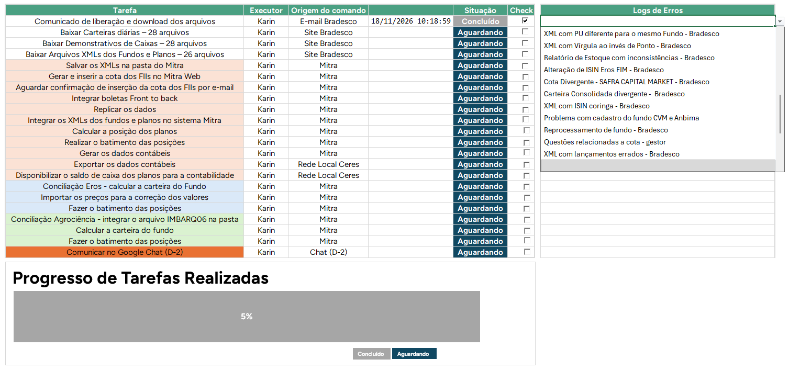
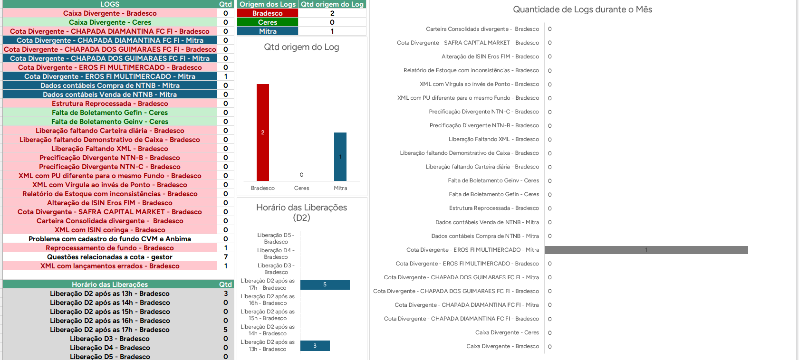

# **Checklist diário**
Para o processo de fechamento D-2, é importante seguir o Checklist Diário (pasta: GEMOI/BackOffice/CheckList Diário - Rotina), que resume as etapas apresentadas neste manual e permite o registro de eventuais obstáculos enfrentados no processo de recebimento dos dados do custodiante, de cálculo das posições e de utilização do sistema Mitra. Esse registro é importante para ser apresentado em reunião com o custodiante, de modo a alinhar as dificuldades que surgiram e encontrar soluções de forma eficiente.

Cada dia a ser conciliado possui uma aba individual, que apresenta as principais etapas na coluna D. Conforme a execução das atividades listadas, basta marcar o check da coluna I, que executa uma macro para registro do horário e atualiza o percentual de tarefas que já foram realizadas no decorrer do dia e do mês. Na coluna K, é possível registrar eventuais logs, que atualizam a aba "Logs do Mês", apresentada abaixo.

Caso surja a necessidade de acrescentar um novo log à lista, é possível inserir na coluna A, devendo conter em sua descrição (preferencialmente) Bradesco, Ceres ou Mitra, para que a fórmula parametrizada aceite a condicional e a contabilização dos logs seja devidamente sensibilizada.

Essas informações servem como insumo e pauta para a reunião mensal com o custodiante.