# **Liberação de dados pelo custodiante**

A rotina de fechamento do D-2 se inicia com o e-mail de aviso da liberação das informações pelo custodiante, cujo assunto é "LIBERAÇÃO CERES - DATA", que faz referência à data disponibilizada dessas informações. A partir dessa sinalização, inicia-se a etapa de download dos arquivos das carteiras diárias, dos demonstrativos de caixa e dos arquivos <code>.xml</code> dos planos de benefícios e dos fundos da Ceres, no [site do Bradesco](https://bc2.custodia.bradesco/calilogin/login.jsf?lang=1).

Todos os relatórios são obtidos da aba **Custódia e Controladoria de Ativos** e requerem a escolha de um grupo de carteiras. Caso ainda não exista um grupo de carteiras configurado em seu usuário, acesse Relatórios > Cadastro de Grupo de Carteiras. Clique em Novo, e depois em "Selecionar Todas as Carteiras/Fundos" e, por fim, defina um nome para o grupo.

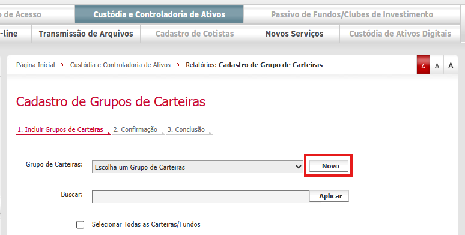

## **Obter as informações do custodiante**

Para todos os arquivos a serem baixados, o Grupo de Carteiras será composto por **todas** as carteiras e fundos da Ceres, conforme criado acima. Em cada etapa, para selecionar o grupo desejado, clique no botão de lupa e, na janela que abrir, em Pesquisar para visualizar os grupos de carteira criados e selecionar o desejado.

### **Carteira diária**
Acessada em Custódia e Controladoria de Ativos > Relatórios > Posição > Carteira Diária. Marque apenas a opção XLS, sendo que a Data Inicial é referente ao dia de conciliação. O download dessas carteiras deve ser feito individualmente, para cada dia que foi liberado pelo custodiante.

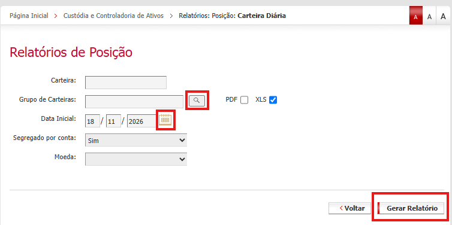

## **Demonstrativo de Caixa**
Acessado em Custódia e Controladoria de Ativos > Relatórios > Movimentação > Demonstrativo de Caixa. Marque apenas a opção XLS, sendo que a Data Inicial é o primeiro dia do mês em exercício e a Data Final é o último dia de liberação. Para esses relatórios, não há necessidade de gerar o relatório individual.

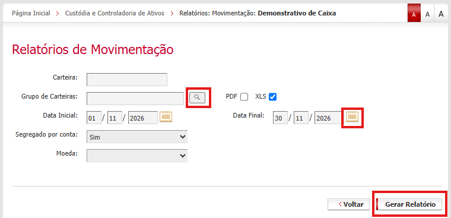

### **XML Anbima**
Acessado em Custódia e Controladoria de Ativos > Relatórios > XML Anbima. A Data de Posição é referente ao dia de conciliação. O download desses arquivos deve ser feito individualmente, para cada dia que foi liberado pelo custodiante.

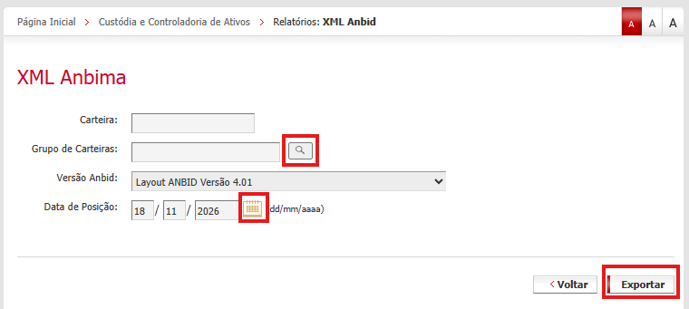

### **Download dos relatórios**
Os relatórios gerados são obtidos em Custódia e Controladoria de Ativos > Relatórios > Extração de Arquivos (Book / Grupo de Carteiras) > Protocolo de Book e Grupo de Carteiras > Consultar. Observe o número do protocolo para saber qual arquivo é referente à carteira diária, ao demonstrativo de caixa e ao XML Anbima: a numeração segue a ordem em que os relatórios foram gerados.

## **Salvar os arquivos nos diretórios do Mitra**
Acesse a VPN do Mitra e salve os relatórios gerados em suas respectivas pastas, cujos diretórios estão parametrizados e são acessados pelo Mitra para obter as informações necessárias (pelos arquivos XML, enquanto as carteiras diárias e demonstrativos de caixa são salvos para referência gerencial). É preciso criar uma pasta para cada dia de conciliação, seguindo o padrão já existente:

* **Carteiras diárias:** <code>D:/LUZ Soluções Financeiras/ARQUIVOS INTEGRAÇÃO/CARTEIRA DIARIA</code> - criar uma pasta para cada dia (padrão DDMM)
* **Demonstrativos de caixa:** <code>D:/LUZ Soluções Financeiras/ARQUIVOS INTEGRAÇÃO/CARTEIRA DIARIA</code> - criar uma pasta com data referente à data final escolhida para a geração deste relatório (padrão D.CAIXA DD MÊS)
* **XML Anbima:** <code>D:/LUZ Soluções Financeiras/ARQUIVOS INTEGRAÇÃO/FUNDOS RECON</code>

No caso dos arquivos XML, salve o arquivo <code>zip</code> na pasta do dia de conciliação, extraia todos os arquivos, copie todos os XML **com exceção** do arquivo referente a **CERES CONSOLIDADA** e cole os arquivos na pasta FUNDOS RECON.

Os arquivos <code>.xml</code> que estiverem presentes nesta pasta serão considerados na etapa de integração do Mitra (quando o sistema lê os arquivos e obtém as informações do XML), por isso é importante ter cuidado com quais arquivos permanecem nessa pasta. Em caso de integração duplicada para o mesmo dia, consulte a aba de [Resolução de problemas](3_problemas.md).

### **Obter cotas FII**
As cotas diárias do FII RB CAPITAL DESENV RESIDENCIAL II são calculadas à parte e incluídas manualmente pelo Mitra Web:

1. Copie todos os XML referentes aos **planos de benefícios** da pasta Fundos Recon para a pasta <code>D:/LUZ Soluções Financeiras/ARQUIVOS INTEGRAÇÃO/PU/PU PLANOS/XMLS</code>. Caso existam arquivos XML na pasta, exclua-os.
2. Na pasta PU PLANOS, execute o atalho <code>IMPORTACAO_PLANOS</code>, que gera um arquivo excel com as cotas do FII.
3. Copie as células com informações, acesse o [Mitra Web](https://mitraweb.luz-ef.com/), cole os dados, clique em Validar e em Salvar.
4. Aguarde o e-mail de confirmação da inclusão das cotas.

> **ATENÇÃO:** Caso ocorra o reprocessamento dos arquivos liberados, basta incluir a cota recalculada para a mesma data, pois o Mitra sobrescreve com a cota registrada mais recente para cada dia.

## **Etapas do Mitra**
### Integrar as boletas
A integração das boletas que entram por meio dos lançamentos no módulo de front do Mitra deve ser feita para que as boletas lançadas e aprovadas sejam integradas no módulo de MiddleOffice, de forma que essas informações também passem a alimentar o banco de dados do sistema, que será utilizado para os cálculos de fechamento.

1. Iniciar o **Mitra Produção**.
2. Na aba Front, selecionar Integrações > Integrar Boletas Front to Back.
3. Antes de clicar em Integrar, aparecem "Boletas para integrar: x" e "Boletas integradas: -".
4. Após clicar em Integrar, aparecem "Boletas para integrar: x" e "Boletas integradas: x".
5. É necessário clicar em Integrar mais uma vez, para aparecer "Boletas para integrar: x" e "Boletas integradas: 0".

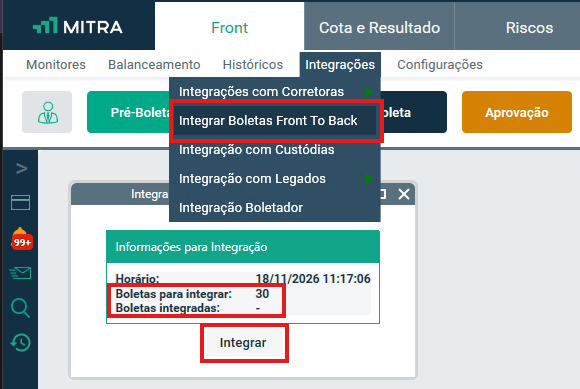

### Replicar os dados
O funcionamento interno do Mitra é dado pela captação de informações de diversas fontes de dados para uma base chamada <code>lef_series</code>. Após o tratamento desses dados, as informações passam a integrar uma base chamada <code>LEF Risco 2000</code>, que alimenta as bases dos clientes da Luz.

A etapa de replicação de dados é equivalente a uma atualização dessa base consolidada, de forma a executar as rotinas com as informações mais atualizadas disponíveis. Essa etapa também é necessária para atualizar a base com quaisquer registros de cotas feitos pelo Mitra Web.

Após receber o e-mail de confirmação de inserção dos dados no Mitra Web:

1. No canto superior direito do Mitra, clicar no botão de Replicação de Dados ({width="3%"}).
2. Clique em Replicar Preços na janela que abrir.

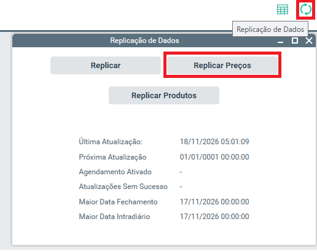

### Integrar os arquivos XML na base de dados do Mitra
Nessa etapa, as informações fornecidas pelo custodiante são integradas para a base de dados do Mitra para a realização do batimento das posições entre o Mitra e o Bradesco.

1. No canto superior direito, clique em Cadastros Gerais ({width="2%"}) > Integrações > Monitor Pipeline.
2. Selecione o pipeline "Integração D-2" e clique em Calcular.

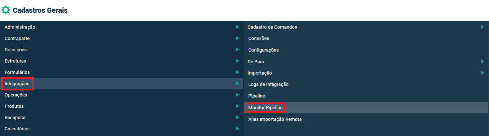

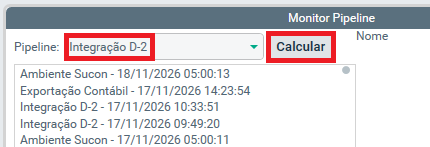

### Calcular as posições

1. Clique na aba de Cota e Resultado para expandir a lista de programas no botão <code>></code> na barra lateral esquerda.
2. Selecione o programa **[RECON] FUNDAÇÃO CERES** clicando duas vezes.
3. Na parte de programas selecionados, clique com o botão direito no programa > Definições > Apuração > Geral para definir as datas de cálculo: Data final = dia de cálculo da conciliação e Data inicial = dia **útil** anterior à data final.

> Esse cálculo deve ser feito **dia a dia** para conferência e fechamento.

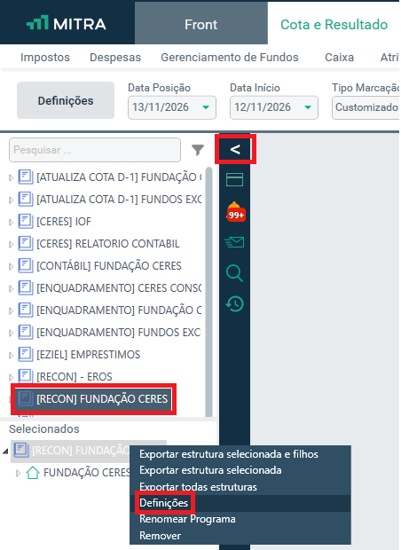
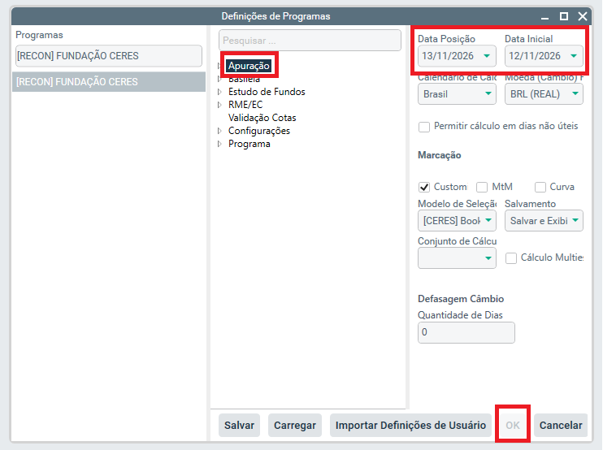

### Conferir a conciliação

1. Finalizado o cálculo, abrir o Book Preços Consolidado.
2. Filtrar a coluna Produto, selecionando todos e retirando aqueles que são referentes a empréstimos, financiamentos, imóveis, PL e Caixa.
3. Verificar nas colunas de Diferença se houve alguma divergência.
4. Em seguida, selecionar apenas o produto Caixa e verificar se houve alguma divergência.

> Na coluna do Financeiro com os produtos selecionados, é normal dar uma diferença em torno de R$ 5 mil, devido à diferença de precificação das NTN-B e NTN-C entre as metodologias do custodiante e do Mitra.

> Em caso de divergências que não relacionadas a precificação de NTN-B, consultar a página de [Resolução de problemas](3_problemas.md).

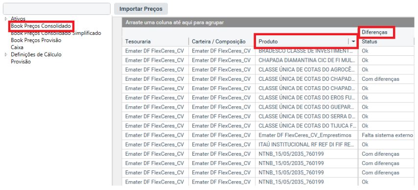

### Gerar e enviar os dados contábeis
Após conferir a conciliação e não observar diferenças entre o Mitra e o custodiante, ou identificar apenas diferenças mapeadas (como a precificação de títulos públicos, ou diferenças de centavos de caixa), é necessário gerar os dados contábeis para disponibilizá-los para a GCONT.

1. Desselecionar o programa [RECON] FUNDAÇÃO CERES clicando duas vezes.
2. Selecionar o programa **[CONTÁBIL] FUNDAÇÃO CERES**.
3. Clicar com o botão direito no programa selecionado, como foi feito em [RECON] FUNDAÇÃO CERES > Definições > Apuração > Geral e selecionar a Data final = data da última conciliação e Data inicial = último dia útil antes da primeira data a ser calculada. Por exemplo, para calcular dos dias 10/11/2026 a 13/11/2026, a data inicial será 09/11/2026.
4. Após a finalização do cálculo, clicar em Salvar > Travar Dados Contábeis

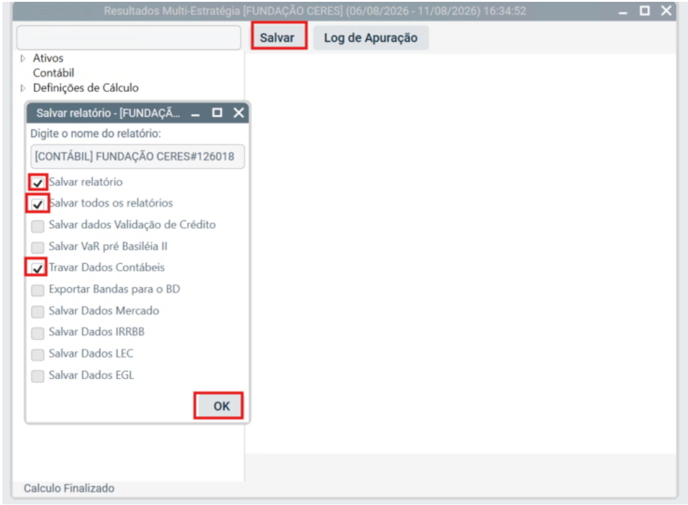

> Para exportar os dados para a contabilidade: Cadastros Gerais ({width="2%"}) > Integração > Monitor Pipeline > selecionar o pipeline **Exportação Contábil** > Calcular

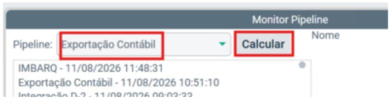

### Disponibilizar o saldo de caixa para a Contabilidade
Após realizar a conciliação, gerar os dados contábeis e exportar para a GCONT, também é necessário disponibilizar, no drive compartilhdo, o saldo de caixa dos planos.

1. Abrir o **Mitra Relatórios Produção**.
2. Fechar todas as planilhas excel que estiverem abertas.
3. No diretório D:/LUZ Soluções Financeiras/ARQUIVOS INTEGRAÇÃO/SALDOS DE CAIXA, abrir a planilha <code>SALDO CAIXA CUSTÓDIA - MODELO.xlsx</code>.
4. Selecionar a aba Mitra > Gerar relatório > na janela de navegação que abrir à direita, clicar em Gerar relatório novamente > escolher as datas: Data inicial = primeiro dia do mês e Data final = último dia de conciliação > Clicar em Ok.
5. Será aberta outra planilha, que deve ser salva na mesma pasta seguindo o modelo <code>CAIXA_DD_MM_AAAA.xlsx</code>.
6. Copiar a planilha para a pasta compartilhada com a contabilidade: <code>G:/Drives compartilhados/GECOR_GCONT/RELATORIO DE FECHAMENTO_GEMOI_MITRA</code>.

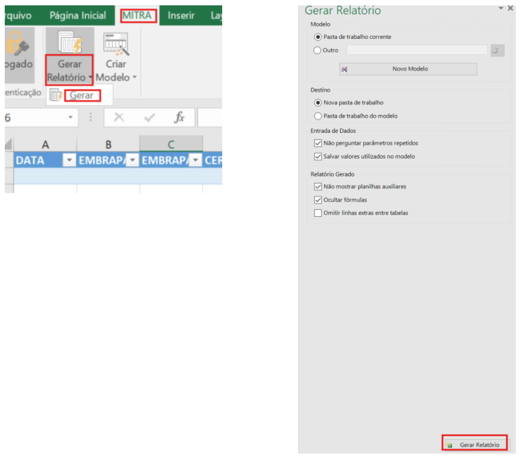

## Conciliar os fundos exclusivos
Junto com o fechamento diário, também fazemos a conciliação dos fundos exclusivos de gestão própria da Ceres: FIA Agrociência e FIM Eros.

> Cada fundo deve ser conciliado **individualmente**.

1. Selecionar a carteira do fundo na barra lateral esquerda, dentro de FUNDOS EXCLUSIVOS, clicando duas vezes.
   
   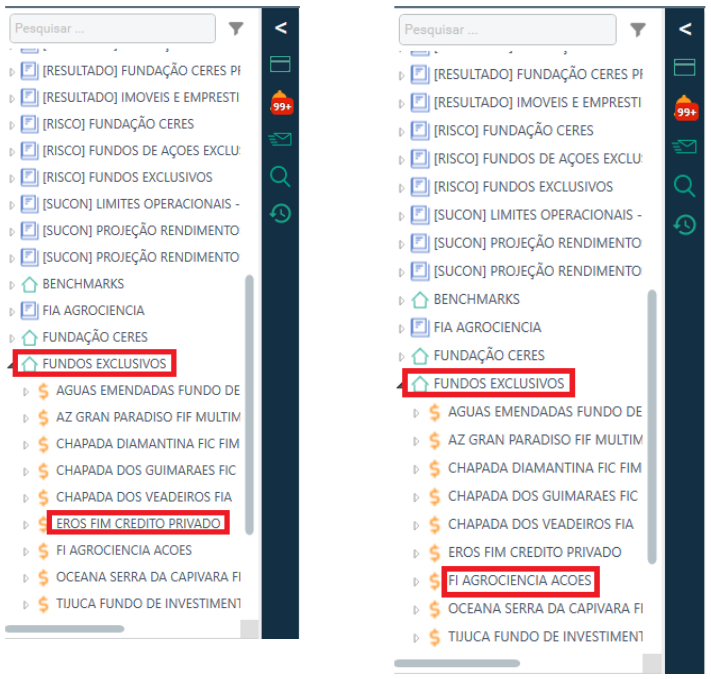
2. Na barra de Definições, selecionar Data Posição = dia de conciliação e Data Início = dia útil anterior à data de conciliação, e calcular.
   
   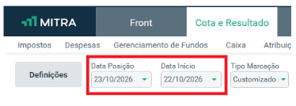

### **Eros**
Ao fim do cálculo, abrir o Book Preços Consolidado. No caso desse fundo, é necessário fazer a Importação de preços, para que os preços e as cotas do fundo sejam atualizados para o padrão da Anbima no Mitra.

> Caso hajam diferenças de **quantidade**, buscar pela solução na página de [Resolução de problemas](3_problemas.md).

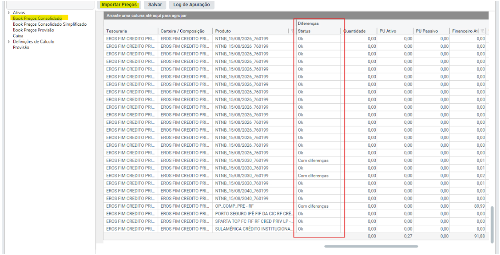

### **Agro**
Para a conciliação do FIA Agrociência Ações, é necessário obter o arquivo IMBARQ06 do [site iMercado da B3](http://imercado.bmfbovespa.com.br/iMercadoConciliacao/home) e fazer a integração no Mitra:

1. Acessar o site e, após a autenticação por código enviado por e-mail, selecionar Participante: 585 e Categoria: FCAO.
2. Na barra de navegação superior, selecionar Solicitações > Download de arquivos > Buscar e procurar os arquivos IMBARQ06 para baixar.

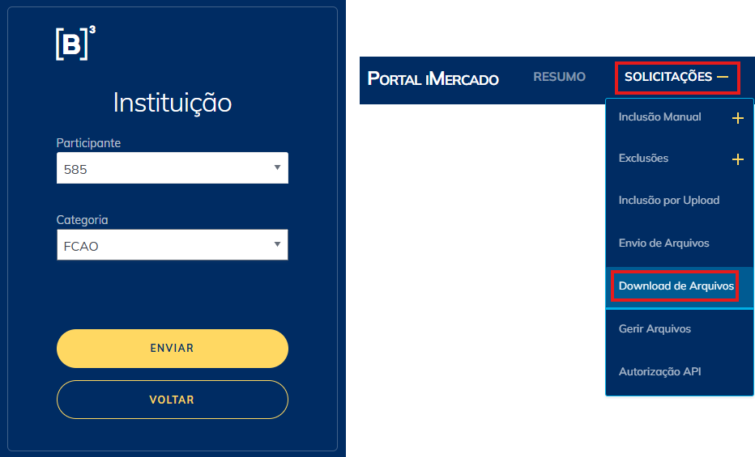

O site usa uma janela móvel de informações, na qual os arquivos ficam disponíveis por oito dias. Conforme novos arquivos são acrescentados, os mais antigos são excluídos, de forma que é importante sempre acessar e fazer o download para evitar perder algum dia.

> **Importante:** deve-se ter atenção para **não subir os dados IMBARQ duplicados**, pois a correção é complexa.

Após fazer o download do arquivo:

1. Salvar o arquivo na VPN do Mitra em <code>D:/LUZ Soluções Financeiras/ARQUIVOS INTEGRAÇÃO/IMBARQ</code>, de acordo com o ano e mês do arquivo.
2. Pegar o arquivo <code>.txt</code> dentro do <code>.zip</code> e colar na pasta IMBARQ.
3. Realizar a integração **individualmente**, mesmo que exista mais de um dia para conciliar: no Mitra, Cadastros Gerais ({width="2%"}) > Integrações > Monitor Pipeline > selecionar o pipeline **IMBARQ** > Calcular.

> É de costume deixar o **último** arquivo IMBARQ integrado na pasta IMBARQ, para facilitar o controle dos arquivos que já foram integrados no Mitra e evitar o erro de duplicidade das informações.

A conciliação do FIA Agro segue os mesmos passos que a do Eros, com exceção da Importação de Preços. No caso do Agro, deve-se observar as diferenças geradas pelo BOVA11 e BOVV11, além do Caixa.

> Na ocasião de haver diferenças na **quantidade**, é possível que o arquivo IMBARQ da data calculada não tenha sido integrado ao Mitra ainda.

## Comunicar no chat D-2
Ao concluir a rotina, é necessário comunicar no grupo de chat D-2 que os movimentos do dia conciliado foram exportados. A GCONT dará prosseguimento, então, às checagens das informações enviadas pelo sistema e pela GEFIN, realizando o respectivo batimento.

Após a GCONT enviar a tela com o batimento das informações, caso haja alguma divergência superior às diferenças de centavos, será necessário fazer a devida verificação. Não havendo diferenças, a rotina de conciliação do dia está concluída.