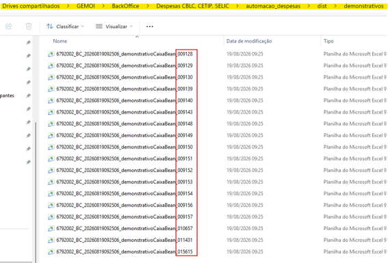
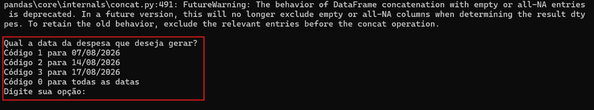

# Rotinas fora do Mitra

## Envio de despesas para a Gefin
As despesas financeiras relacionadas às taxas de custódia e controladoria, bem como CBLC, Selic e CETIP, costumam ocorrer por volta das mesmas datas, mas também estão sujeitas ao critério da custódia.

|          |            Dia 07            |               Dia 15              |
|----------|:----------------------------:|:---------------------------------:|
| **Despesas** | Custódia Controladoria CETIP | Selic CBLC (quando há incidência) |

Após a liberação da estrutura de carteiras pelo custodiante, salvar os demonstrativos de caixa dos planos de benefícios na pasta <code>G:/Drives compartilhados/GEMOI/BackOffice/Despesas CBLC, CETIP, SELIC/automacao_despesas/dist/demonstrativos</code>.

Executar o arquivo <code>automacao_despesas.exe</code> e aguardar o retorno do programa, que vai perguntar para qual data as despesas serão geradas. Digitar a opção e apertar Enter. O programa vai salvar o arquivo com a data referenciada na pasta.

Abrir o arquivo, ajustar o tamanho das colunas, tirar um print para enviar por e-mail e salvar.

Enviar o e-mail para:

* gefin@ceres.org.br
* lista.monitoramento@ceres.org.br
* sinderlino@ceres.org.br

No dia 07, o assunto é "Despesas Custódia e Controladoria - 07/MM/AAAA".

No dia 15, o assunto é "Despesas SELIC - 15/MM/AAAA".