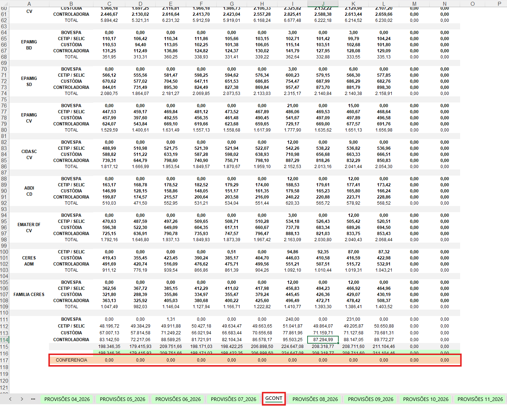

# Rotina de fechamento mensal

## Provisões para o fechamento
As provisões de fechamento são geradas com os arquivos XML dos planos de benefícios no último dia **útil** do mês.

1. Salvar os arquivos na pasta <code>G:/Drives compartilhados/GEMOI/BackOffice/Despesas CBLC, CETIP, SELIC/provisoes_fechamento</code>.
2. Abrir o arquivo <code>codigo_provisoes.R</code>, no momento salvo em <code>C:/Users/Karin Kawano/Desktop/programas/provisoes</code>
3. Atualizar as variáveis <code>mes</code> e <code>ano</code>.
4. Executar o código, que vai gerar um arquivo <code>.docx</code> com as tabelas das provisões de todos os planos de benefícios e um arquivo <code>.xlsx</code> com as tabelas em excel.
5. Acessar a pasta <code>G:/Drives compartilhados/GECOR_GCONT/RELATORIO DE FECHAMENTO_GEMOI_MITRA</code> e abrir o excel referente ao ano de exercício (<code>TABELA DE PROVISÃO_Atualizada - 2026.xlsx</code>).
6. Na aba referente ao mês de fechamento, inserir as informações geradas na estrutura de tabela existente.
7. Conferir, na aba GCONT, se a linha 17 de <code>CONFERENCIA</code> está zerada, o que indica que as informações foram inseridas corretamente.
8. Conferir, também, com os valores da carteira consolidada (9214).

### Enviar memorando pelo SE Suite
1. Copiar o arquivo <code>.docx</code> do último memorando na pasta <code>G:/Drives compartilhados/GEMOI/Correspondências/Memorandos/ANO</code> e colar as tabelas geradas no arquivo <code>.docs</code> pelo <code>R</code>.
2. Emitir o memorando pelo SE Suite e enviar para:
    *  gcont@ceres.org.br
    *  evaldo@ceres.org.br
    *  lista.monitoramento@ceres.org.br

