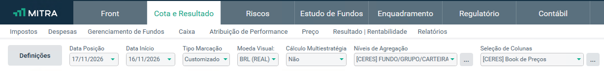

## Estrutura

O Mitra possui diferentes módulos, sendo que os principais para as atividades de back office são Front, Cota e Resultado, e Contábil.

### Módulo Front
É nesse módulo que a Geinv realiza o cadastro das boletas, que refletem as movimentações de aporte ou resgate. As boletas devem ser integradas ao módulo de MiddleOffice, de forma que passem a alimentar integralmente o banco de dados do sistema. Esse processo é realizado em <code>Front > Integrações > Integrar Boletas Front to Back</code>, e faz parte do passo a passo do [fechamento em D-2](../fechamento/2_manual.md).

Além disso, é também nesse módulo que realizamos o cadastro do Caixa Online, que permite que a Geinv tenha uma sensibilidade maior dos caixas dos planos para realizar as operações no início do dia. Esse processo é realizado em <code>Front > Monitores > Cadastro de Caixa Online</code> e se encontra detalhado no [manual de caixa online](../proj_caixa/caixa_online.md).

### Módulo Cota e Resultado
Esse módulo dá acesso à lista de programas, que podem ser expandidos na seta <code>></code>, na barra de navegação à esquerda. Para utilizar um programa, basta clicar nele duas vezes, mandando-o para a lista de programas selecionados. Com o botão direito, é possível definir os parâmetros de cálculo, como a data de início e fim a serem consideradas.

Além dos programas ({width="2%"}), também existem as carteiras ({width="2%"}). No caso do cálculo utilizando as carteiras (que abrangem os fundos exclusivos, ou mesmo os planos de benefícios individuais), é necessário definir as datas de posição e de início na barra superior de parâmetros:

### Módulo Contábil
Esse módulo permite o cadastro e definição de parâmetros contábeis, como Conta Contábil, Dados Contábeis, entre outros. É utilizado principalmente durante o período de cadastro de algum fundo, ou atualização de algum de-para.

## Cadastros Gerais
Os Cadastros Gerais agregam funcionalidades como de integração, operações e recuperação de formulários salvos, acessado no canto superior direito, em {width="2%"}.

### Integração
Cadastros Gerais > Integração > Monitor Pipeline

Os pipelines são responsáveis por buscar os arquivos XML nos respectivos diretórios para importar as informações para o sistema Mitra.

* Integração D-2: importa as informações das carteiras diárias e demonstrativos de caixa liberados pelo custodiante para fechamento em D-2, conciliando com os valores do próprio Mitra.
* Exportação Contábil: exporta os dados contábeis gerados nos fechamentos diários ou de mês, disponibilizando para a Gcont.
* IMBARQ: importa as informações do FIA Agrociência Ações do arquivo IMBARQ06.

Cada execução de integração gera um log, que apresenta eventuais erros e avisos. Esses logs podem ser recuperados em Integrações > Logs de integração.

### Operações
#### Fundos
Cadastros Gerais > Operações > Fundos > Fundos

Ambiente acessado para editar lançamentos de fundos, como os de recebimento do FII Hermes, que foram provisionados para as 48 parcelas futuras com valor fixo da primeira e datas de recebimento conforme contrato de venda. Os recebimentos têm acontecido alguns dias antes do dia previsto, levantando a necessidade de ajuste não só do valor financeiro (que é atualizado pelo INPC) mas também da data de liquidação.

#### Lançamentos
Cadastros Gerais > Operações > Lançamentos

Eventuais necessidades de ajuste de caixa ou de quantidade são importados manualmente por meio dessa funcionalidade.

#### Renda fixa
Cadastros Gerais > Operações > Renda Fixa > Operações de Renda Fixa com Filtro

Permite editar e/ou remover operações de renda fixa, como a exclusão de operações compromissadas duplicadas que são eventualmente geradas caso os arquivos XML de uma liberação diária sejam integrados mais de uma vez no Mitra por engano.

#### Remover
Cadastros Gerais > Operações > Remover

Com a estrutura (programa) selecionado na barra de navegação à esquerda, no módulo de Cota e Resultado, é possível remover as informações importadas e as informações geradas, em caso de duplicidade ou de reprocessamento: as informações importadas dizem respeito às informações integradas a partir dos arquivos XML, enquanto dentre as informações geradas estão os dados contábeis.

### Produtos

### Recuperar
Cadastros Gerais > Recuperar > Formulários salvos

Toda execução do programa [RECON] FUNDAÇÃO CERES ou [CONTÁBIL] FUNDAÇÃO CERES gera um formulário salvo com os resultados, para serem consultados novamente sem a necessidade de realizar o cálculo inteiro. Os cálculos de conciliação e fechamento dos fundos exclusivos de gestão própria (FIA Agrociência e FIM Eros) não são salvos automaticamente.
