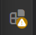
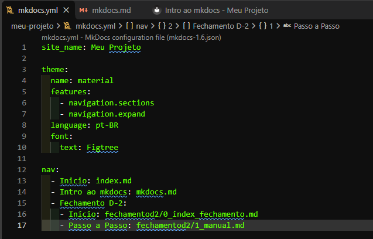

# **Introdução à biblioteca MkDocs**

O MkDocs é um gerador de sites voltado para documentação. O conteúdo é escrito em arquivos Markdown (.md), que permitem alta flexibilidade e versatilidade para diagramação de texto, e a estrutura é feita em um único arquivo de configuração (.yml).

## **Como utilizar o MkDocs?**

### Instalar Python e VS Code
Após instalar o VS Code, é necessário instalar as extensões (<code>Ctrl+Shift+X</code> ou {width="4%"}):

1. Python (Microsoft)
2. Markdown All in One - opcional, mas ajuda a escrever Markdown
3. YAML (Red Hat) - opcional, mas ajuda a apontar erros de indentação no arquivo yml

### Criar pasta do projeto e ativar ambiente virtual
1. Crie uma pasta no seu diretório de escolha e, no VS Code, vá em **Arquivo > Abrir Pasta** e selecione a pasta criada.
2. Abra o terminal integrado com <code>Ctrl+'</code> e ative o ambiente virtual (<code>python -m venv .venv</code>)
3. Em seguida, <code>.venv\Scripts\activate</code>
4. Selecione o interpretador no VS Code: <code>Ctrl+Shift+P</code> e digite **Python:Select Interpreter**
5. Escolha o que tem <code>.venv</code>

### Instalar o MkDocs
Com o ambiente ativado, digite no terminal:

<code>
python -m pip install --upgrade pip  
pip install mkdocs-material
</code>

### Estrutura inicial do site
Ao digitar <code>mkdocs new .</code> no terminal, o comando cria a estrutura básica modelo de um site, que consiste em um arquivo chamado <code>mkdocs.yml</code> e uma pasta <code>docs/</code> com um índice padrão chamado <code>index.md</code>.

#### <code>mkdocs.yml</code>
O arquivo <code>.yml</code> recebe toda a configuração do site: linguagem, fonte, tema, hierarquia das páginas etc. Novas páginas <code>.md</code> podem ser criadas conforme a necessidade e o conteúdo a ser disponibilizado, devendo ser referenciadas no arquivo <code>.yml</code> para serem renderizadas no site.

No exemplo acima, o <code>theme</code> configura alguns parâmetros básicos do tema do site, como a linguagem e a fonte utilizadas. Já <code>nav</code> determina a estrutura das páginas, sendo possível também criar novas pastas dentro de <code>docs/</code>, criar os arquivos <code>.md</code> desejados dentro de cada uma para melhor organização, e depois referenciá-las na navegação. A pasta <code>fechamentod2</code> possui dois arquivos: <code>0_index_fechamento.md</code> e <code>1_manual.md</code>.

#### Arquivos markdown
O conteúdo a ser disponibilizado no site é registrado em arquivos Markdown (<code>.md</code>), que é uma forma simplificada de formatar texto usando programação simples, sem a necessidade de botões de editor ou de HTML.